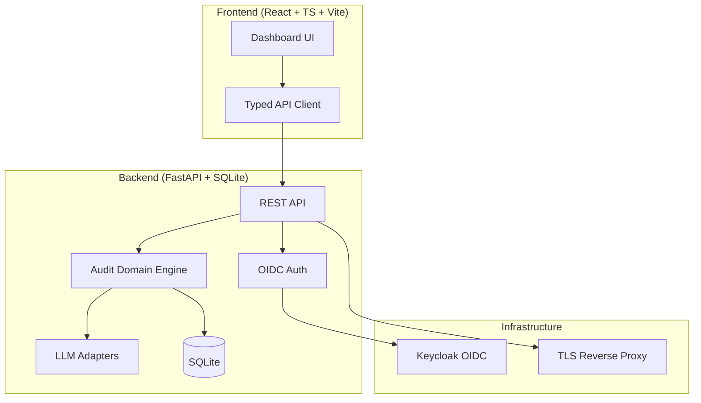

# Orbit Pilot

> Work in progress. This checkpoint may be incomplete or fail tests. See PLAN.md and STATUS.md before use.


A coding-agent skill for multi-phase security audits with independently verified, machine-readable findings.

## Quick Start

### Prerequisites
- Python 3.12+
- Node 24+
- Docker & Docker Compose

### Development Setup

```bash
# Backend
python3 -m venv .venv
source .venv/bin/activate
pip install -r backend/requirements.txt
PYTHONPATH=backend python -m pytest backend/tests -v

# Frontend
cd frontend
npm install
npm run build
npm test

# Full stack with Docker
docker compose up --build
```

### Environment
Copy `.env.example` to `.env` and fill in values:
```bash
cp .env.example .env
```

## Architecture



## Features

- **Multi-phase security audits**: Reconnaissance → Hunting → Validation → Reporting
- **Machine-readable findings**: JSON schema with CWE, optional CVSS, references
- **Coverage ledger**: Track audit completeness across attempts
- **Independent validation**: Separate verifier phase for each finding
- **LLM provider agnostic**: OpenAI-compatible, Anthropic, Gemini, Ollama
- **OIDC authentication**: Keycloak with SAML broker support
- **Role-based access**: Viewer, Operator, Admin roles

## API Endpoints

| Method | Path | Description |
|--------|------|-------------|
| GET | /health | Health check |
| GET | /api/v1/audits | List audits |
| POST | /api/v1/audits | Create audit |
| GET | /api/v1/audits/{id} | Get audit details |
| GET | /api/v1/audits/{id}/findings | List findings |
| GET | /api/v1/audits/{id}/coverage | Get coverage ledger |
| POST | /api/v1/audits/{id}/run | Start audit run |

## Security

- All API endpoints require authentication (except /health)
- HttpOnly SameSite cookies with CSRF protection
- OIDC tokens validated for signature, issuer, audience
- No hardcoded secrets; `.env.example` with blank credentials
- Demo mode binds to localhost only; refuses in production

## AI/ML Evaluation

Orbit Pilot implements a deterministic offline core for security audit orchestration. LLM explanations are opt-in, labeled advisory, and grounded in actual records.

### Reproducible Baseline
```bash
# Run evaluation on seeded target
python -m orbit_pilot.eval --target seeded-target --runs 3
```

**Measured Results** (from upstream blind comparison, n=3 per arm):
- Precision: median 90% (strong tier), 89% (weak tier)
- Recall: median 47% (strong tier), 27% (weak tier)
- Decoy hit rate: 0%
- Cost: ~$30/run (quick profile, strong tier)

**Known Limitations** (from GitHub issues #20, #88, #80, #53, #86, #81):
1. Advisory/CVE grounding not attempted by design
2. Domain-correctness defects outside taxonomy may be missed
3. Quick profile fragile to malformed hunter returns
4. Exploitability gating may downgrade real defects
5. Cost/recall ratio unfavorable vs. simpler methods
6. Windows validator CLI needs lstat/fstat fallback
7. Coverage ledger artifact sharing within attempt rejected
8. Remediation records lack preserved_uses tracking

## Configuration

### LLM Providers
| Provider | Env Vars | Default Base URL |
|----------|----------|------------------|
| OpenAI-compatible | LLM_API_KEY, LLM_MODEL, LLM_BASE_URL | https://api.openai.com/v1 |
| Anthropic | LLM_API_KEY, LLM_MODEL, LLM_BASE_URL | https://api.anthropic.com |
| Gemini | LLM_API_KEY, LLM_MODEL, LLM_BASE_URL | https://generativelanguage.googleapis.com |
| Ollama | LLM_BASE_URL, LLM_MODEL | http://localhost:11434 |

### Keycloak
| Variable | Description |
|----------|-------------|
| KEYCLOAK_URL | Keycloak base URL |
| KEYCLOAK_REALM | Realm name |
| KEYCLOAK_CLIENT_ID | Client ID |
| KEYCLOAK_CLIENT_SECRET | Client secret |

## License

MIT Copyright Ryan Vo <ryandtvo@gmail.com>